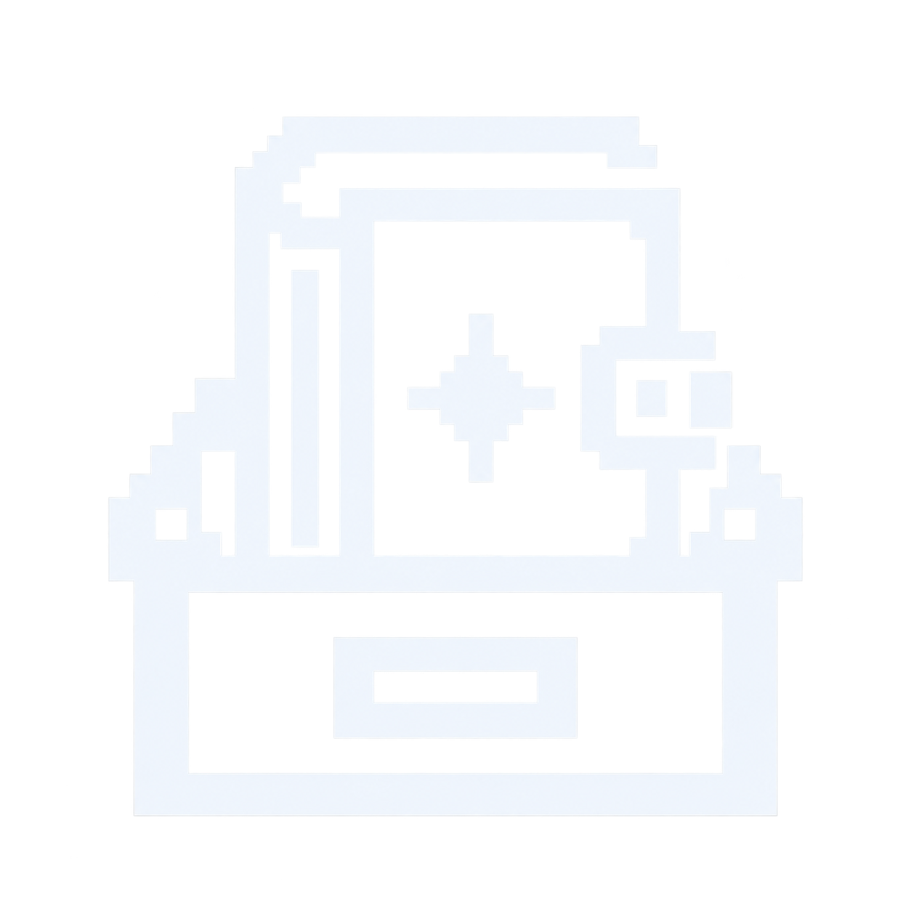

#  Archivist

Archivist is a lightweight archive manager for Omarchy. It follows your current theme and gives you a simple place to open, extract, and edit archives.

## What it does

- Opens archives and extracts everything or just the files you select.
- Creates and edits ZIP, 7z, TAR, TAR.GZ, TAR.BZ2, TAR.XZ, and TAR.ZST archives.
- Creates and edits RAR archives when the `rar` command is installed. Readable RAR archives can still be opened and extracted without it.
- Shows progress, speed, and time remaining during extraction and most edits.

## Install

Download the latest Omarchy package from [Releases](https://github.com/seth-reee/archivist/releases), then install it from your Downloads folder:

```bash
sudo pacman -U ./archivist-*.pkg.tar.zst
```

The package recipe supports Omarchy on x86_64 and ARM64, using Arch Linux and Arch Linux ARM respectively. Install the package whose filename matches your machine's architecture. To build from the tagged release, install `base-devel`, `cmake`, `ninja`, `qt6-base`, `libarchive`, and `pkgconf`, then run `makepkg -s` in `packaging/`.

**ARM64 status:** The ARM64 package built and launched headlessly under QEMU, but remains untested on a real ARM64 Omarchy desktop.

Open **Archivist** from the application menu.

## Use

Choose **New archive** to pick a name, location, format, and compression level. Add files and folders with their separate picker buttons; both appear in the same archive, and folders include their nested contents. You can also start with an empty archive. Choose **Open** to browse an existing archive, then use **Extract** or the edit buttons in the toolbar.

Drag files and folders into an empty Archivist window to start a new archive, or into an open editable archive to add them. You can also drop them into the file list in **New archive**. Dropping a single readable archive into an empty window opens it.

Select entries and drag them into your file manager to extract copies, including the contents of selected folders. Files are prepared before the drag starts; large selections may take some time. Temporary extracted copies remain available until Archivist closes, so allow the file manager to finish copying before closing it. Dragging never removes entries from the archive.

When extracting the whole archive, Archivist creates a folder named after the archive if its contents are not already inside one top-level folder. If that destination name already exists, it uses a numbered folder. Extracting selected entries keeps the destination you choose.

Archivist skips unsafe archive paths and does not overwrite existing extracted files. Password protected and split archives are not supported yet.

## Build from source

Requires CMake, Qt 6 Widgets, and libarchive.

```bash
cmake -S . -B build
cmake --build build
./build/archivist
```

## Automated packages

Every push to `master` automatically prepares the next patch version, builds native x86_64 and ARM64 Arch packages, and publishes a GitHub release after both builds pass. The workflow commits the new version and pinned source checksum, pushes the matching tag, uploads both packages and their source, and verifies the uploaded checksums before publishing. It uses the built-in GitHub token and does not trigger recursive releases. If you increase the version in `CMakeLists.txt` and `packaging/PKGBUILD` yourself, that untagged version is used instead of an automatic patch bump.

Pull requests build development packages without publishing. Manual runs on `master` also release; matching `vVERSION` tags build and publish that version. Artifacts are available from the **Arch Linux packages** workflow: download the architecture artifact and `archivist-source` for the package, source archive, recipe, and checksums. Existing published releases are verified rather than replaced.

Both architectures run the archive and widget tests, verify package metadata and ELF architecture, and perform an offscreen startup check. These checks do not replace testing on a real desktop.

## License

Archivist is made by [seth-reee](https://github.com/seth-reee) and is available under the [MIT License](LICENSE).
